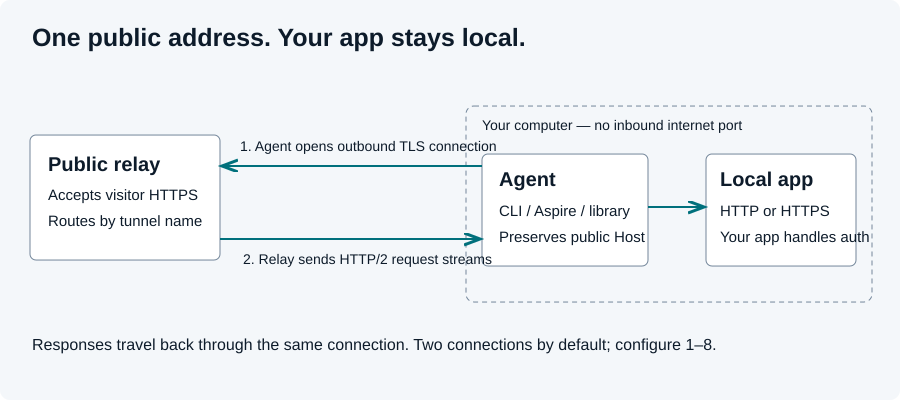

# Groundhog client handbook

Connect one local application to a Groundhog relay using Aspire, a command-line tool, or an embedded Agent.
The clients share protocol version 1 and the same connection and forwarding behavior.

| Task | Guide |
| --- | --- |
| First working Aspire tunnel | [Runnable quickstart](../samples/AspireQuickstart/README.md) |
| Integrate with your AppHost | [Aspire reference](aspire.md) |
| Run the CLI or embed the Agent | [Agent and CLI reference](agent.md) |
| Keyboard menus, tunnel management and traffic queries | [CLI guide](cli.md) |
| Diagnose failures or update credentials | [Troubleshooting](troubleshooting.md) |
| Understand ownership and public source | [Source provenance](source-provenance.md) |
| Implement an interoperable relay | [Protocol contract](protocol.md) |
| Build, test or publish packages | [Contributing](../CONTRIBUTING.md), [release procedure](client-release.md) |

## Before installing

Open your service's website, sign in, and create or join a workspace. Create a tunnel and save its one-time
connection key privately. The website's `/docs/workspace` and `/docs/create-tunnel` describe those steps for that
deployment. The client needs the **tunnel name**, not the workspace slug or full public URL.

CLI and Aspire use the hosted service by default. For a self-hosted relay, supply its base address explicitly;
the tunnel and credential must exist on that relay. The embedded Agent requires an explicit relay URI.
The relay repository owns dashboard and workspace behavior. The CLI can manage tunnels through an upgraded relay's
workspace API; workspace creation remains on the website.

## Select the client

| Client | Best fit | How it runs | Configuration |
| --- | --- | --- | --- |
| `Groundhog.Aspire.Hosting` | Applications already orchestrated by Aspire | Agent inside AppHost; no separate CLI process | Secret key parameter and one endpoint reference |
| `Groundhog.Cli` | Any local HTTP/HTTPS application | `groundhog host` in a terminal | Name, `--port` or `--target`, `GROUNDHOG_KEY` |
| `Groundhog.Agent` | Custom tools and applications | `GroundhogAgent.RunAsync` in your process | Explicit relay, name, credential, local target |
| `Groundhog.Protocol` | Interoperability and transport building blocks | Library; does not host a tunnel by itself | Protocol constants and primitives |

The Agent keeps two connections by default (configurable from one to eight). The relay uses HTTP/2 inside the
outbound WebSocket so requests can run concurrently. The local app receives ordinary HTTP requests, with its
public Host preserved. Local HTTPS is available when configured; public HTTPS does not require local HTTPS.

## Verify the whole path

1. Open your app's local URL and confirm it answers.
2. Start the client with the exact tunnel name and its key.
3. Check the client and website report Connected.
4. Open the public HTTPS address copied from the website.
5. Confirm your app's expected response and find that request in the client log or dashboard feed.

Keep both the app and client running. Connected describes the relay connection, not the health of your app.
The tunnel does not deploy your app or authenticate its visitors. Apply app authentication and webhook signature
validation as usual. For request capture and usage, use your service's `/docs/inspect-traffic` guide.

## Protect configuration

Use a hidden prompt for `GROUNDHOG_KEY` or an Aspire secret parameter. User secrets are outside the repository,
but are not encrypted. Never include actual keys in examples, screenshots, logs or issue reports. Treat invitation
links as private too. Examples in this handbook use `example.com` and placeholders.

After rotating a key in the dashboard, update the secret and restart the stopped client. After renaming, also update
the name, callbacks and allowed hosts. Use a separate name for each simultaneously running machine or AppHost.
