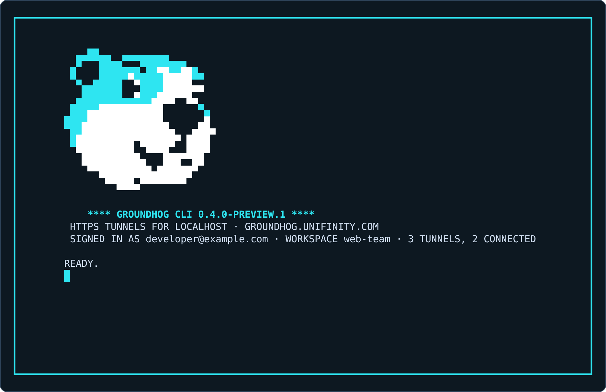
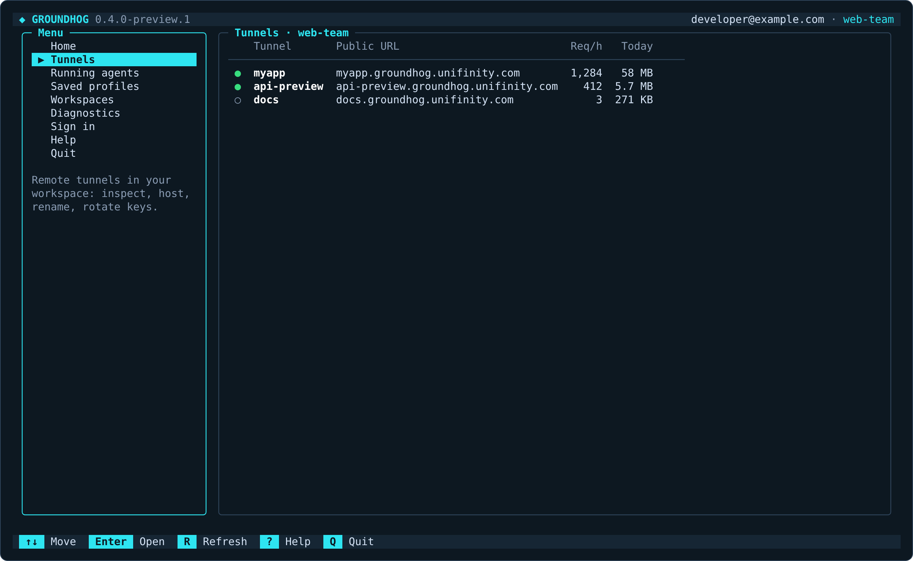
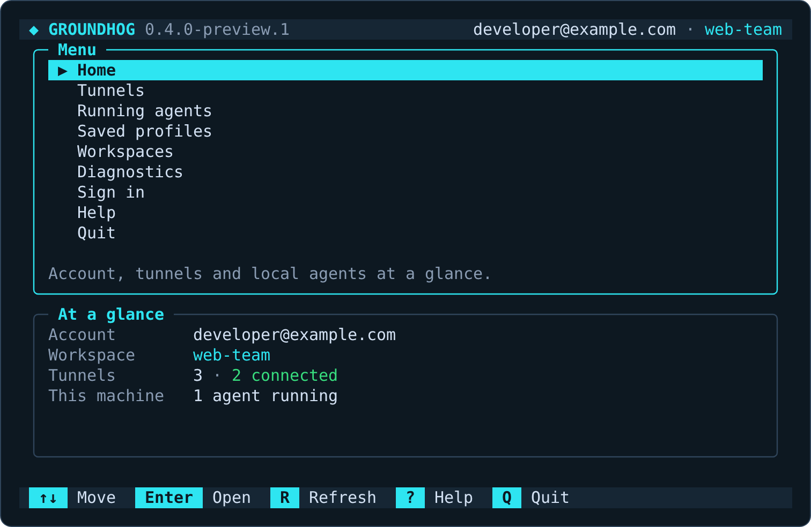
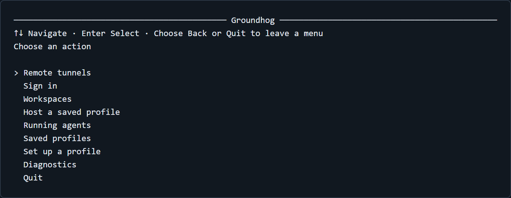
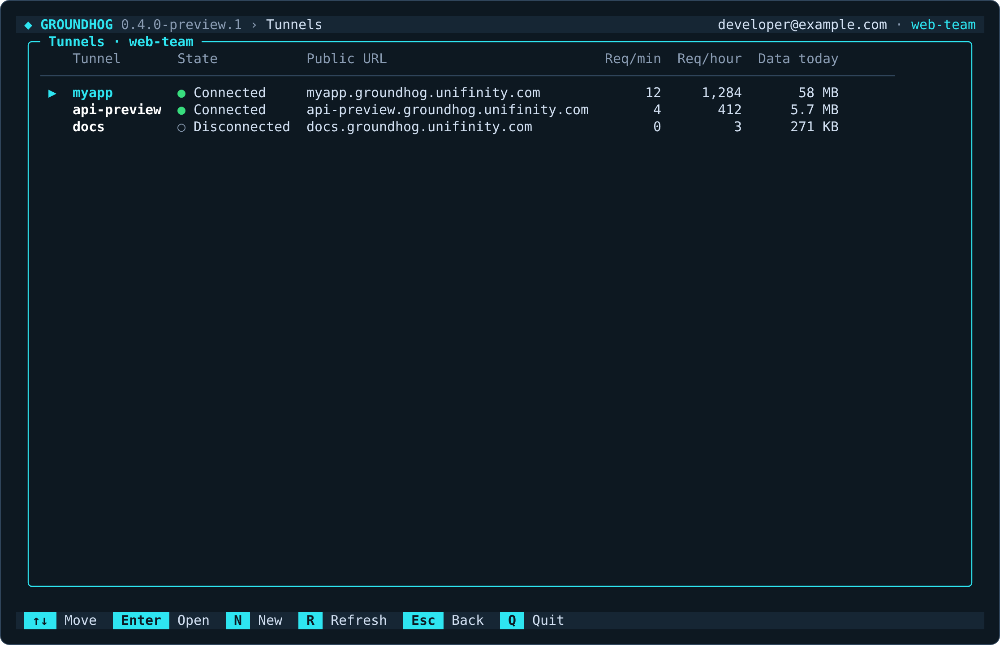
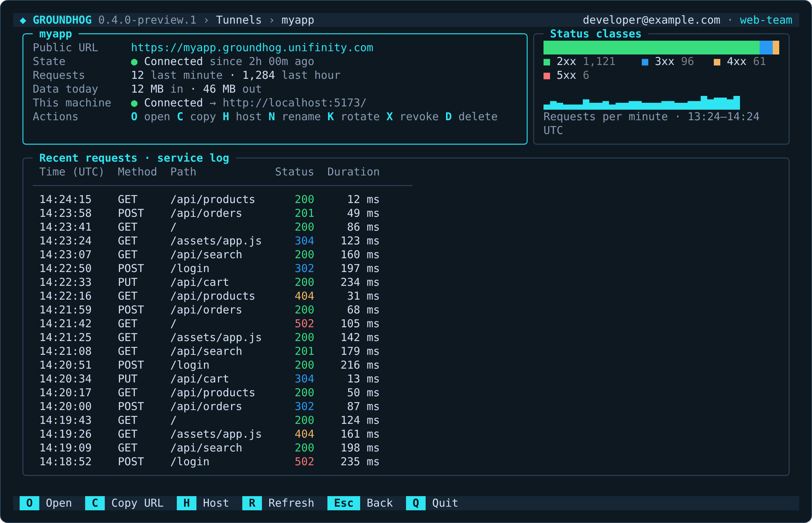
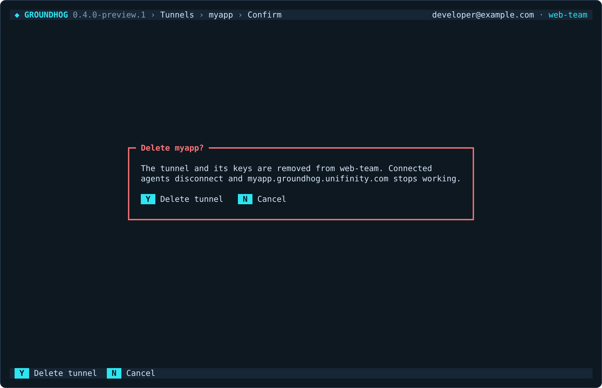
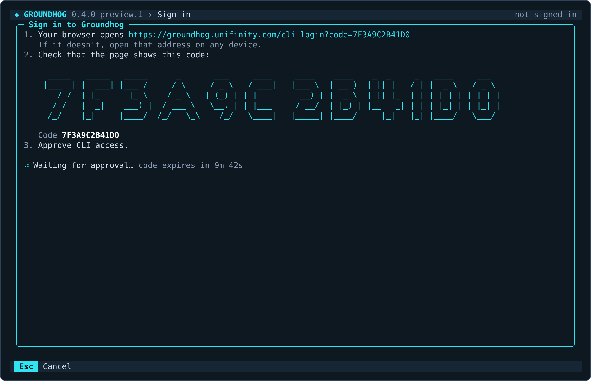
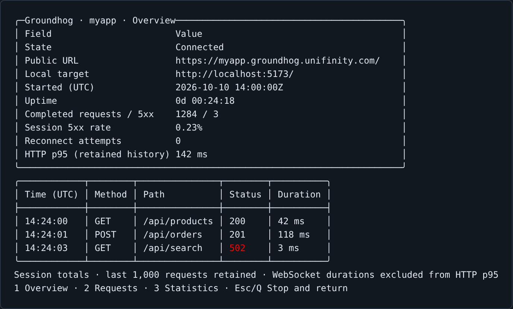
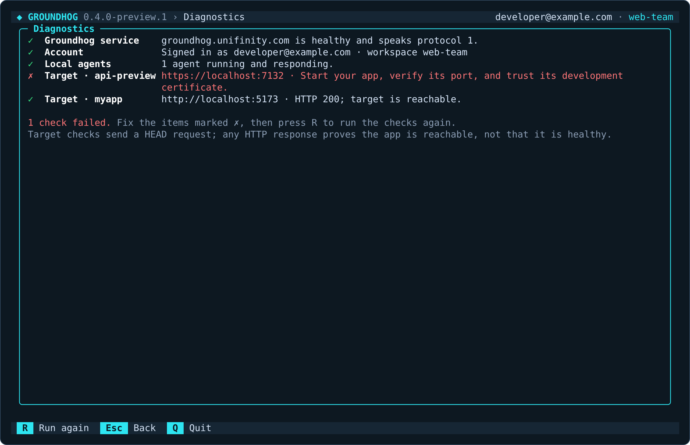

# Groundhog CLI

Groundhog provides a full-screen terminal app, live tunnel dashboards and commands for scripts.
Requires .NET 10 and the ASP.NET Core runtime (both are included with the SDK).

```sh
dotnet tool install --global Groundhog.Cli --version 1.0.0
groundhog
```

In an interactive terminal, `groundhog` (or `groundhog dashboard`) opens a full-screen app. It runs in the terminal's
alternate screen, so every view is drawn in full and replaced rather than printed below the last one, and leaving the
app restores your terminal and its scrollback exactly as they were. Terminals without an alternate screen are cleared
instead. Redirected input or output, and `--no-interactive`, print help instead of opening the app; scripts are unaffected.



The launch screen shows the version, your account and workspace, how many tunnels are connected and, when there is
one, a newer CLI version. It stays until you press **Enter**; **Q** or **Esc** quits, and **U** installs an available
update (see [updating](#check-for-updates-and-update-the-cli)).

On Windows the CLI switches the console to UTF-8 while it runs and restores the previous code page when it exits.
Windows consoles otherwise start in a legacy code page that can't draw the app's symbols, which showed up as `?`
characters and made the full-screen app scroll on every redraw.

### The menu



Every screen has the same frame: a header bar with the version, where you are, your account and workspace; the body; a
status line for the outcome of the last action; and a footer listing the keys that work on that screen. The menu lists
the app's screens on the left. On terminals at least 100 columns wide, the right pane previews the highlighted entry
(hovering **Tunnels** shows the tunnel table). A preview is for looking only: open the screen with Enter to use its
keys. The number beside each entry opens it directly. Narrower terminals, down to 80×24, show the menu with a summary instead,
and dashboards stack their panels and drop less important columns.



| Screen | Shows |
| --- | --- |
| Home | Account and workspace, tunnels with state, address, requests and data, agents on this machine, and requests per tunnel in the last hour |
| Tunnels | The workspace's tunnels; Enter opens a tunnel, N creates one |
| Tunnel detail | Public URL, state, traffic totals, a status-class breakdown, requests per minute and the service's recent request log, updated live as requests finish, with actions |
| Running agents | Agents hosting from this machine; Enter opens a live view of one, S stops it |
| Saved profiles | [Saved profiles](#saved-profiles) (a tunnel name plus your app's local address) and whether each is running; Enter hosts one here, B starts it in the background, A adds, D deletes |
| Workspaces | Your workspaces as a tree with the highlighted workspace's tunnels; Enter makes it the default |
| Diagnostics | The doctor checks as a live checklist: service health, sign-in, local agents and each saved profile's target |
| Sign in | Browser-approved sign-in with the code shown large; sign out when already signed in |
| Help | Every key, and the version |



### Keys

| Key | Action |
| --- | --- |
| ↑ ↓ (or j k), Home, End, PgUp, PgDn | Move the highlight |
| Enter | Open the highlighted item |
| 1–9 | Open a menu entry directly |
| Esc or Backspace | Back to the previous screen |
| R | Refresh |
| ? or F1 | Help |
| Q | Quit (Ctrl+C also quits) |

Data refreshes by itself while a dashboard is open: local agents every few seconds, the account and tunnels every 30
seconds. A tunnel's request log follows the service live while its screen is open; its title says `live`,
`reconnecting…`, or `service log` with the reason when live updates stopped (R reloads). Text entry (a tunnel name, a local target) and confirmations appear inside the frame; while you type, letters
are text rather than shortcuts.

### Tunnels and their actions





The tunnel dashboard lists the actions your role permits:

| Key | Action |
| --- | --- |
| O | Open the public URL in your browser (the address is shown when no browser is available) |
| C | Copy the public URL through your terminal's clipboard support (OSC 52); the address is shown either way |
| H | Host the tunnel from this machine: enter the local target, then the live view opens |
| N | Rename (asks for the new name) |
| A | Add a second connection key and save it on this machine; agents using the old key stay connected |
| K | Rotate the connection key and save the new one on this machine |
| X | Revoke every key |
| D | Delete |

Add key, rotate, revoke and delete ask for confirmation inside the frame; Y confirms and N or Esc cancels. Each action
runs the same code as its command (`open`, `rename`, `key add`, `key rotate`, `key revoke`, `delete`), so permissions, saved keys and
messages are identical.



The screenshots are the real renderer's output with synthetic sample data. See
[screenshot generation](#refresh-the-screenshots) to reproduce them.

## Check for updates and update the CLI

Groundhog checks NuGet for a newer CLI at most once every 24 hours.

- **The full-screen app** checks in the background, so it never delays starting. A newer version appears on the
  launch screen and in the top bar on every start until you install it. Press **U** on any screen (or on the launch
  screen) and confirm with **Y**; Groundhog closes and installs it.
- **Other interactive commands** print one line, such as `Groundhog CLI 0.5.0 is available (you have 0.4.0). Run
  groundhog update to install it.`, and carry on. They never stop to ask a question.

How the install finishes depends on the platform:

- **macOS and Linux:** the .NET tool installer runs in the same terminal and replaces the CLI in place. Start
  `groundhog` again when it says it's done.
- **Windows:** Windows locks the files of a running program, so a global or tool-path CLI can't replace itself while
  it is open. Groundhog starts a small PowerShell window, exits, and that window waits for Groundhog to close, runs
  the same `dotnet tool update` command and reports the result. Agents started with `groundhog start` and other open
  Groundhog windows hold the same files: stop them first (`groundhog ps`, `groundhog stop <name>`), or the update
  fails and the window tells you to stop them and run `groundhog update` again. Local tools (a `dotnet-tools.json`
  manifest) update in place on every platform.

Running tunnels keep their current client until you restart them.

```sh
groundhog update --check     # Check now without installing or prompting.
groundhog update             # Check now and ask before installing.
groundhog update --yes       # Check and install without a prompt.
```

Stable installations are offered stable releases. Preview installations include previews, and stable users can
opt in with `groundhog update --prerelease`. Only newer, listed Groundhog.Cli packages from NuGet.org are offered.
Updates use the exact selected version and preserve your profiles and credentials.

Global tools, custom tool paths, and local tools with a matching manifest are supported. An unidentified executable
is never used to guess another installation to update. You need the .NET SDK for the installer. If installation
fails, Groundhog reports the failure; retry with `dotnet tool update` for your installation after exiting the CLI.

Command-line checks have a 2-second budget and stay quiet when offline. A check's result, including a failed check,
is cached for 24 hours; explicit `update` commands check again immediately. Redirected commands, JSON output, help,
version, background hosting and `--no-interactive` skip the check. Add `--no-update-check` or set
`GROUNDHOG_NO_UPDATE_CHECK=1` to turn off the notice and the app's update check. Neither option disables an explicit
update command.

## Sign in and find tunnels

Remote commands sign in through the service's CLI authorization API described in [protocol.md](protocol.md#cli-management-authentication).
`host` with a connection key, [saved profiles](#saved-profiles) and local monitoring work without account login.

```sh
groundhog login
groundhog workspace list
groundhog workspace use example
groundhog list
groundhog describe myapp
```

Login displays an approval code and opens the service's sign-in page when interactive. In the app, **Sign in** shows
the code in large type with the address and waits for approval; Esc cancels.

 Sign in through the browser,
check that its code matches your terminal, and approve CLI access. In a headless shell, open the printed URL on
another device. The code expires after ten minutes; the resulting CLI session expires after eight hours.
Signing in replaces the saved session.

`list` includes connected and disconnected remote tunnels in the selected workspace. `ls` is an alias.
`describe` shows a tunnel's remote state, public URL, traffic totals and permitted actions; `show` is an alias.
`ps` lists processes on this machine. A remote tunnel can be connected by an agent on a different machine.

```sh
groundhog list --status connected --output json
groundhog describe myapp --workspace example --output json
groundhog whoami
groundhog logout
```

Logout revokes the saved remote credential and removes local credentials and saved connection keys.
If the relay cannot be reached, the local copy is still removed, but remote revocation cannot be confirmed;
the credential expires at its original eight-hour deadline.

## Run a tunnel

```sh
groundhog host myapp --port 5173
groundhog host myapp --target https://localhost:7132
```

Supply an existing tunnel's key through `GROUNDHOG_KEY`. Login does not retrieve existing one-time connection keys.
Keys created, added or rotated through this CLI are saved securely and are used when the selected workspace matches.
An explicit `--key` or `GROUNDHOG_KEY` takes precedence. A saved key is never sent to a different service address.



In a terminal, `host` replaces its line-by-line output with a live dashboard in the alternate screen: the public URL,
local target, state, totals, HTTP p95 and reconnects; a status-class breakdown; the latest requests; and connection
events. Press **1** for the overview, **2** for a full-height request list and **3** for statistics (session totals,
p50/p95, status classes and requests per minute). **Esc**, **Backspace** or **Q** stops hosting. Started from the
command line, the terminal is then restored and the command prints `Stopped.` and exits as before; started from the
app (a tunnel's **H** or a saved profile), you return to the screen you came from. Ctrl+C stops the command.
Noninteractive hosting retains the original connection/disconnection output; `--verbose` adds request lines. Use
`--no-interactive` to select that behavior in a terminal.

The host's options are `--port`, `--target`, `--local-ca`, `--insecure-local`, `--key`, `--pool` and `--verbose`,
plus the [visitor access options](#visitor-access-rules) below.
See [the Agent guide](agent.md) for forwarding and certificate behavior.

## Visitor access rules

By default anyone with the address can reach a tunnel. Visitor access rules decide, per path, who may visit:

| Method | Who passes |
| --- | --- |
| `anyone` | Everyone (webhook senders, OAuth providers). Can't be combined with other methods. |
| `members` | Members of the tunnel's workspace, after signing in to Groundhog in the browser. |
| `apikeys` | Requests with one of the tunnel's API keys in the `X-Groundhog-Api-Key` header. |
| `ips` | Requests from one of the tunnel's IP ranges. |

A request passes when any listed method passes. The longest matching path prefix wins (on segment boundaries,
ignoring case); the default rule applies elsewhere. Visitor access is enabled per workspace; where it isn't, the
commands below print "Visitor access rules aren't enabled for this workspace."

An API key is what a caller (a script, a test runner, another service) sends to reach a path. It is not the tunnel's
connection key, which only the hosting agent uses.

### Declare them when hosting

Rules given to `host` are sent with the tunnel's connection and replace the tunnel's stored rules, so they live with
the command or profile that hosts the app:

```sh
export MYAPP_API_KEY=...                      # from groundhog api-key create, or your secret store
groundhog host myapp --port 5173 \
  --allow members \
  --path /webhooks=anyone \
  --path /api=apikeys,ips \
  --ip 203.0.113.0/24 \
  --api-key-env MYAPP_API_KEY
```

| Option | Meaning |
| --- | --- |
| `--allow <methods>` | The default rule: `anyone`, or any of `members`, `apikeys`, `ips` joined by commas. Defaults to `anyone`. |
| `--path <prefix>=<methods>` | A rule for one path prefix, for example `--path /webhooks=anyone`. Repeatable, up to 32. |
| `--ip <cidr>` | An IPv4 or IPv6 range for `ips`, for example `203.0.113.0/24`. Repeatable, up to 64. |
| `--api-key-env <VAR>` | An environment variable holding an API key for `apikeys`. Repeatable, up to 10. Only the key's SHA-256 hash is sent; API keys never go on the command line. |
| `--access-file <file>` | The rules as JSON instead of `--allow`, `--path` and `--ip` (not together with them). |

The access file uses the service's shape, so the output of `groundhog access <name> --output json` can be edited into
one (its `apiKeys` and `managedBy` are ignored):

```json
{
  "default": { "allow": ["members"] },
  "rules": [
    { "path": "/webhooks", "allow": ["anyone"] },
    { "path": "/api", "allow": ["apikeys", "ips"] }
  ],
  "ipRanges": ["203.0.113.0/24"]
}
```

The rules are checked before connecting, with the same rules the service applies. Without any of these options,
`host` leaves the tunnel's stored rules unchanged. If the tunnel's rules are managed in the dashboard, or the service
refuses them, hosting stops with the service's reason (exit code 3). If the service doesn't support visitor access,
hosting stops with "This relay doesn't support visitor access rules; update the relay or remove them." rather than
exposing the app without them.

### Manage them while signed in

```sh
groundhog access myapp                                   # Show the rules, API keys and who manages them.
groundhog access myapp --output json                     # The same, as JSON (a starting point for --access-file).
groundhog access set myapp --allow members --path /webhooks=anyone --ip 203.0.113.0/24
groundhog access set myapp --access-file rules.json
groundhog access myapp --agent-managed                   # Let hosting agents declare the rules again.
groundhog api-key create myapp ci                        # Prints the new API key once.
groundhog api-key list myapp
groundhog api-key revoke myapp <api-key-id>
```

`access set` saves the rules as managed in the dashboard: agents that declare rules are then refused until you run
`access <name> --agent-managed`. API keys live on the service, so `access set` takes no `--api-key-env`; create
them with `api-key create` and copy the printed key, which isn't shown again. `api-key revoke` asks for confirmation;
scripts pass `--yes`. The app's tunnel screen shows the current rules on a **Visitors** line.

## Saved profiles

A **saved profile** remembers what you need to host a tunnel often: its **name**, the **local address your app listens
on** (for example `myapp` → `http://localhost:5173`) and, optionally, its [visitor access options](#visitor-access-rules). With a profile saved, hosting that tunnel again is
one word on the command line, or Enter on **Saved profiles** in the app, instead of retyping the name and target.
A profile never stores a connection key.

What a profile lets you do:

- **Host in the foreground**: `groundhog host myapp` uses the profile's target, and in the app **Saved profiles** →
  Enter opens the live hosting view.
- **Run in the background**: `groundhog start myapp` (or **B** in the app) starts an agent that keeps running after you
  close the terminal; `groundhog restart myapp` restarts it and `groundhog stop myapp` stops it. `start` and `restart`
  only accept saved profiles.
- **Check it**: the app's **Diagnostics** screen checks that each saved profile's local target answers.

Where the key comes from: a profile only names the tunnel, so hosting still needs its connection key. Groundhog uses,
in order, `--key`, the `GROUNDHOG_KEY` environment variable, or the key this CLI saved when you created the tunnel or
rotated its key while signed in (for the selected workspace and the same service address). A tunnel created on the
website has no saved key here; supply it through `GROUNDHOG_KEY`, or rotate its key from the CLI to save one (agents using the old key disconnect).

Create and manage profiles:

```sh
groundhog init                                       # Asks for the tunnel name and local target, then saves them.
groundhog profile save myapp --target http://localhost:5173
groundhog profile save myapp --target http://localhost:5173 --allow members --path /webhooks=anyone \
  --api-key-env MYAPP_API_KEY                           # Saves the variable's name, never the API key.
groundhog profile list
groundhog host myapp                                 # Foreground, with the live view.
groundhog start myapp                                # Background; returns once connected.
groundhog ps
groundhog restart myapp
groundhog stop myapp
groundhog profile delete myapp                       # Removes only the saved name and target.
```

In the app, **Saved profiles** lists each profile with whether it is running on this machine: Enter hosts it here,
**B** starts it in the background, **A** adds one and **D** deletes one. Deleting a profile never touches the tunnel
on the service or a running agent.

A profile's name must be an existing tunnel's name. Saving checks that the target is an `http://` or `https://`
address without a path or credentials, and checks any visitor access options; it does not contact the service.
Profiles save the name, target and visitor access options (an `--access-file` as a full path, `--api-key-env` as
the variable's name; the variable must be set wherever the profile is hosted, including for `start`). Use foreground
`host` with options for a custom CA, connection pool size or `--insecure-local`. After renaming a tunnel,
delete the old profile and save a new one under the new name.

`host <profile>` runs in the foreground. `start` and `restart` return after the agent connects. The background
process is owned by your OS user and runs until stopped, replaced, or terminated; it is not a boot-time service. A
failed or timed-out start stops its newly launched process; run `host` in the foreground to see its error.

Profiles are stored in `profiles.json`, and CLI credentials and saved keys in a separate encrypted file, under the OS
local application-data directory in `Groundhog` (`%LOCALAPPDATA%\Groundhog` on Windows,
`~/.local/share/Groundhog` on Linux). Set `GROUNDHOG_HOME` to use a separate configuration directory (also useful for
isolated automation). Windows credentials use DPAPI for the current user. Unix credential files are created with
owner-only read/write permissions. Saved connection keys remain useful after account session expiry; logout removes
them.

## Observe and query local traffic

From another terminal:

```sh
groundhog status myapp
groundhog stats myapp --watch
groundhog logs myapp --follow
groundhog requests myapp --follow
groundhog requests myapp --status 5xx --since 10m
groundhog requests myapp --method POST --path /api/ --min-duration 500 --limit 50
groundhog requests myapp --output json
```

Local sessions retain the last **1,000 completed requests** and **100 connection events** in memory. They disappear when
the host process exits. Session request and 5xx totals cover the whole run; p95 covers retained HTTP requests and excludes
WebSocket lifetimes. Requests are reported when they finish. Headers, query strings and bodies are excluded.
Paths use substring matching, durations are milliseconds, and `--since` accepts positive numbers with `s`, `m`, or `h`.
Queries return newest first, default to 50 rows, and accept a maximum limit of 1,000.

`--follow` prints newly observed events and `--watch` refreshes status/statistics in place when interactive.
JSON output is a single snapshot and cannot be combined with follow/watch. Local commands communicate with the running
agent over a named pipe restricted to the same OS user; they do not require account login or disclose credentials.

## Inspect remote traffic

```sh
groundhog stats myapp --remote
groundhog requests myapp --remote --status 5xx
groundhog requests myapp --remote --method POST --path /api/ --output json
groundhog requests myapp --remote --follow --status 5xx
```

Remote stats show the relay's stored usage window with status-class counts. Gaps indicate unavailable data;
the current minute may not yet be persisted. Remote requests query the persisted request log and return metadata only.
Status filtering runs on the service; other filters apply to its newest 200 matching records. Remote queries are snapshots,
and their availability and retention depend on the service configuration. They work even when no local agent is running.
`--follow` prints the snapshot, then one line per request as the service finishes it, until Ctrl+C. Status, method, path and
duration filters apply to every line. It reconnects by itself and fills any gap from the request log, printing each request
once; it stops if the sign-in expires or access is removed. It cannot be combined with `--output json`.

## Diagnose and automate

```sh
groundhog doctor --target http://localhost:5173
groundhog doctor --output json
groundhog wait myapp --condition connected --timeout 30
groundhog wait myapp --condition ready --timeout 30
```

Doctor checks relay health/protocol compatibility and, when provided, the local target with a HEAD request.
The app's **Diagnostics** screen runs the same checks, plus your sign-in, local agents and every saved profile's
target, as an animated checklist.


Any HTTP response proves target reachability; it does not prove application health. `wait --condition connected`
requires a live relay connection; `ready` additionally requires a successful local HEAD response. Readiness is local
and does not test public DNS or end-to-end visitor forwarding. Diagnostics preserve normal TLS validation.

Use `--output json` for read commands, `--no-interactive` to disable the app and live views, and `--no-color` (or
`NO_COLOR`) to disable colors; the app keeps its markers (▶, ●, ○, ✓, ✗) without color. Errors go to stderr. Exit codes: 0 success/clean stop, 1 operational failure, 2 invalid arguments/local configuration,
3 a rejected hosting key or unknown hosted tunnel. Every command supports `--help`.

## Manage tunnel definitions

```sh
groundhog create myapp
groundhog rename myapp demo
groundhog key add demo
groundhog key list demo
groundhog key rotate demo
groundhog key revoke demo
groundhog delete demo
groundhog open demo
```

Mutations use the same workspace permissions as the website. `create`, `key add` and `key rotate` save their one-time
key locally without printing it. Rename moves a CLI-saved key to the new name, but you must update [saved profiles](#saved-profiles) and app callback URLs.
Rename, deletion, rotation and revocation can disconnect agents; the CLI asks for confirmation. Scripts must pass `--yes`.
`key add` and `key list` disconnect nothing and don't ask. `key revoke <name>` removes all live keys for the tunnel, and
`key revoke <name> <key-id>` removes one. Rotation replaces every key with a new one; restart hosting to use it.

### Rotate a connection key without downtime

A tunnel can have two live connection keys at once. `key rotate` replaces every key and disconnects agents immediately,
so the public address stops answering until hosting restarts. To replace a key while the app stays reachable, add a
second key, move hosting to it, and then revoke the old key. Run these steps on the computer that hosts the tunnel:
the new key is saved there and never printed.

First, add a key. Agents already connected keep using the old key, which keeps working until you revoke it:

```sh
groundhog key add my-tunnel
```

The new key is saved on this computer for `groundhog host my-tunnel`, replacing the key saved there before. If
`my-tunnel` already has two live keys, the command stops with
`A tunnel has at most 2 connection keys. Revoke one first` and changes nothing. If the AppHost reads the tunnel from
[user secrets](#put-a-tunnel-in-an-aspire-apphosts-user-secrets), add `--project` so the new key is written there too:

```sh
groundhog key add my-tunnel --project AppHost/AppHost.csproj
```

`Parameters:groundhog-tunnel-name` is `my-tunnel` and `Parameters:groundhog-tunnel-key` is the new key.

Next, restart hosting so the agent connects with the new key: stop `groundhog host my-tunnel` and run it again, run
`groundhog restart <saved-profile>` for a background agent, or restart the AppHost. Hosting that passes the old key
through `GROUNDHOG_KEY` or `--key` keeps using it, because those take precedence over the saved key.

Then check which key each agent uses. Revoking a key disconnects every agent that still uses it, so make sure none do:

```sh
groundhog key list my-tunnel
```

```text
ID                                Created (UTC)     Last used (UTC)   Connected
0123456789abcdef0123456789abcdef  2026-10-01 09:00  2026-10-14 08:55  No
fedcba9876543210fedcba9876543210  2026-10-14 09:00  2026-10-14 09:02  Yes
```

Keys are listed oldest first, so the first row is the old key. Its `Connected` column is `No`: no agent uses it any
more. The new key, `fedcba9876543210fedcba9876543210`, is `Yes`. A key no agent has used shows `Never` under
`Last used (UTC)`. `--output json` prints the same keys as JSON.

Finally, revoke the old key by its ID. The CLI asks for confirmation; scripts pass `--yes`:

```sh
groundhog key revoke my-tunnel 0123456789abcdef0123456789abcdef
```

The CLI prints `Key 01234567 revoked. Agents that used it were disconnected.` The new key keeps working and stays
saved on this computer. A key's ID can't be worked out from the key itself, so revoking one key never removes the key
saved here.

If a key may be compromised, use `groundhog key rotate my-tunnel` instead: it revokes every key and disconnects all
agents at once, so nobody can keep using the old key while you switch. A relay that doesn't support two keys yet
answers `key add` with `This relay doesn't support adding keys yet`; use `key rotate` there.

### Put a tunnel in an Aspire AppHost's user secrets

On a team, each developer hosts the same Aspire AppHost through their own tunnel. In the AppHost,
`WithGroundhogTunnel()` without a tunnel name reads the tunnel's name and connection key from the parameters
`groundhog-tunnel-name` and `groundhog-tunnel-key` (see [one tunnel per developer](aspire.md#one-tunnel-per-developer)). Add `--project` with the AppHost's project file to
`create`, `key add` or `key rotate`, and the CLI writes both values into that project's .NET user secrets:

```sh
groundhog create my-tunnel-dev1 --project AppHost/AppHost.csproj
```

The tunnel is created as without `--project`, its key is saved for `groundhog host` as usual, and the CLI prints
`Set Parameters:groundhog-tunnel-name and Parameters:groundhog-tunnel-key in the user secrets of AppHost/AppHost.csproj.`
In the AppHost's user secrets, `Parameters:groundhog-tunnel-name` is `my-tunnel-dev1` and
`Parameters:groundhog-tunnel-key` is the new connection key. The key is never printed.

A tunnel created earlier from this CLI already has its key saved on this computer. `key copy` writes that saved key,
without changing the tunnel:

```sh
groundhog key copy my-tunnel-dev1 --project AppHost/AppHost.csproj
```

`key copy` sets the same two values as `create --project`. A tunnel created in the Groundhog dashboard or on another
computer has no saved key here, and the service never returns an existing key. For that tunnel, rotate the key; anything
still using the old key disconnects. To keep the old key working while you switch, use `key add` instead, as in
[rotate a connection key without downtime](#rotate-a-connection-key-without-downtime):

```sh
groundhog key rotate my-tunnel-dev1 --project AppHost/AppHost.csproj
```

`Parameters:groundhog-tunnel-key` is then the rotated key. `create` without `--project` prints the `key copy` command
for the tunnel it created.

If the AppHost declares its own parameters under other names and passes them to `AddGroundhogTunnel`, pass those
names with `--name-parameter` and `--key-parameter`.
These two options only work together with `--project`:

```sh
groundhog key copy my-tunnel-dev1 --project AppHost/AppHost.csproj \
  --name-parameter web-tunnel-name --key-parameter web-tunnel-key
```

`Parameters:web-tunnel-name` is `my-tunnel-dev1` and `Parameters:web-tunnel-key` is the saved connection key.

The project needs a `UserSecretsId`, which Aspire AppHost templates include. If it has none, the command stops before
it creates or rotates anything and asks you to run `dotnet user-secrets init --project AppHost/AppHost.csproj`. The
CLI reads a literal `<UserSecretsId>` from the project file, or else from the nearest `Directory.Build.props` above it.
It writes `secrets.json` directly, in the folder `dotnet user-secrets` uses (`%APPDATA%\Microsoft\UserSecrets\<id>` on
Windows, `~/.microsoft/usersecrets/<id>` on Linux and macOS), so the key never appears on a command line. Other
secrets in the file are kept.

## Refresh the screenshots

The CLI tests export renderer output when `GROUNDHOG_SCREENSHOT_DIR` is set. Generate the PNGs with the companion script:

```powershell
$env:GROUNDHOG_SCREENSHOT_DIR = "$PWD/artifacts/screenshots"
dotnet test --project tests/Groundhog.Cli.Tests/Groundhog.Cli.Tests.csproj -c Release
node tools/cli-screenshots.cjs artifacts/screenshots docs/images
```

The screenshot script requires the `playwright` Node package and its Chromium browser (install in a temporary tooling
directory, then set `NODE_PATH` to that directory's `node_modules`). It paints each exported frame cell by cell, like a
terminal. The captures use public sample data, not a production account.

The pixel-art groundhog on the boot and help screens is generated from the brand icon with
`node tools/groundhog-pixels.cjs`, which rewrites `src/Groundhog.Cli/Views/GroundhogPixels.cs`.
