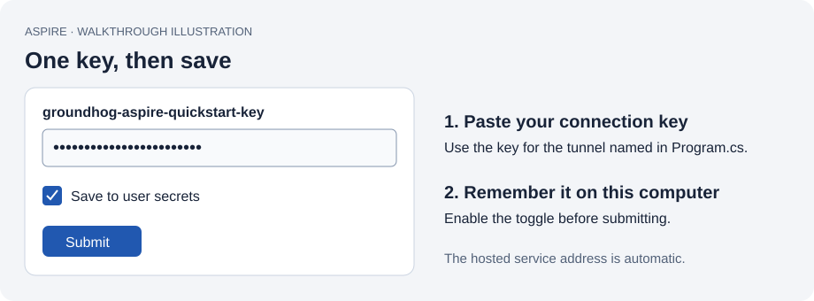
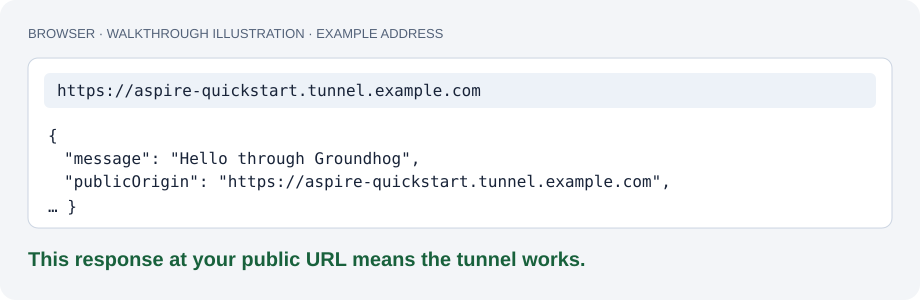

# Your first Groundhog tunnel with Aspire

Run a small web app on your computer and open it through a public HTTPS address. Groundhog runs inside the Aspire AppHost: you do not need to install the Groundhog CLI or host a backend.

This walkthrough targets **0.4.0-preview.1**. If that version has not appeared on NuGet yet, use the
[published preview.3 walkthrough](https://github.com/Unifinity-Software/groundhog-client/tree/agent-v0.2.0-preview.3/samples/AspireQuickstart) until publication completes.

## 1. Check your tools

You need the [.NET 10 SDK](https://dotnet.microsoft.com/download/dotnet/10.0), the [Aspire CLI](https://aspire.dev/get-started/install-cli/), and a Groundhog account. The sample uses Aspire AppHost SDK 13.6.1. In a terminal, check:

```text
dotnet --version
aspire --version
```

The first command should report `10.x`; use Aspire CLI 13.6 or later.

## 2. Create your free workspace and tunnel

Open **[the Groundhog website](https://groundhog.unifinity.com)**. Before starting Aspire, you need a workspace and a tunnel:

1. Follow **[Create your free workspace](https://groundhog.unifinity.com/docs/workspace)** to sign in, choose your workspace name and address, read the Terms of Use, and create the workspace. If you already belong to a workspace, open it instead.
2. Follow **[Create a tunnel](https://groundhog.unifinity.com/docs/create-tunnel)** from your workspace's **Tunnels** page. For this sample, use `aspire-quickstart` or another available name. Leave **Local port** at its default: Aspire forwards to the web app's actual endpoint automatically; the website's field only fills in its standalone CLI command.
3. Keep the exact tunnel **name**, its one-time **connection key**, and its **public HTTPS address** ready for the steps below. If you lose the key, regenerate it on the tunnel's page; the new key replaces the old one.

The hosted guides contain the website's step-by-step instructions and pictures. Your workspace address is a dashboard path, not the tunnel name or public hostname.

You now have two values to enter in Aspire: **the name** and **the connection key**. The website also shows a public HTTPS address. You will open that address after starting the sample. Do not paste that address into the tunnel-name field.

## 3. Download the sample and open its folder

Clone this repository, or download its ZIP from GitHub's **Code** menu and extract it. If you use Git:

```text
git clone https://github.com/Unifinity-Software/groundhog-client.git
cd groundhog-client
git switch --detach agent-v0.4.0-preview.1
cd samples/AspireQuickstart
```

For a ZIP, download the **[0.4.0-preview.1 ZIP](https://github.com/Unifinity-Software/groundhog-client/archive/refs/tags/agent-v0.4.0-preview.1.zip)** rather than the default branch, extract it, and open a terminal in its `samples/AspireQuickstart` folder. You should see the `AppHost` and `Web` folders. This sample installs the integration from NuGet; its only project reference is the example web app.

## 4. Start Aspire and enter your two values

Run this command from the sample folder:

```text
aspire start --apphost AppHost/AppHost.csproj
```

Follow the dashboard link Aspire prints. When the unresolved-parameters form appears:



| Field | Exactly what to enter |
| --- | --- |
| `groundhog-name` | `aspire-quickstart`, or the name you created in step 2. Name only: no `https://`, dots or domain. |
| `groundhog-key` | Paste the connection key from step 2. It is not your account password. |

Turn on **Save to user secrets**, then submit the form. This remembers the values on this computer so you do not have to paste the key every time. User secrets live outside the repository and are not encrypted. Leave the toggle off if you do not want Aspire to remember the values.

There is no service-address question in preview.4. The client connects to the hosted Groundhog service automatically. If you see `groundhog-relay`, stop the old sample and use the preview.4 checkout described below before starting again.

Keep your key out of source files, screenshots and terminal commands. For manual configuration, use the AppHost project's **Manage User Secrets** editor with `Parameters:groundhog-name` and `Parameters:groundhog-key`.

## 5. Open your app through the tunnel

In the Aspire dashboard, wait for `web` to start and `tunnel` to show **Running**. Open the public HTTPS address listed on the `tunnel` resource. Alternatively, open the public address on your tunnel's page in the Groundhog website. Keep the AppHost running.

The `web` resource's localhost link checks only the app on your computer. Use the **public** address to check Groundhog.



The browser should show JSON containing:

```json
{
  "message": "Hello through Groundhog",
  "publicOrigin": "https://aspire-quickstart.groundhog.unifinity.com",
  "host": "aspire-quickstart.groundhog.unifinity.com"
}
```

Your address replaces the example. Seeing **Hello through Groundhog at the public HTTPS address** confirms the complete path works: browser → Groundhog → your local web app → browser. You can now share the public address while your sample is running.

## 6. Stop the sample

From the same sample folder:

```text
aspire stop --apphost AppHost/AppHost.csproj
```

The app will stop serving through the public address. Starting the sample again uses the values you saved.

## If something goes wrong

| What you see | What to do |
| --- | --- |
| `NU1102`, or NuGet only finds an older preview | Check that the requested version is published. If preview.4 is still being released, use the preview.3 walkthrough linked above. Otherwise refresh the cached response with the restore command below. |
| `groundhog-relay` is still requested | You are running an older sample. Stop it and update the checkout with the commands below. Updating a NuGet cache alone does not update your sample's AppHost source. |
| The tunnel rejects the credentials | Check that the name matches the website and the key belongs to that tunnel. A regenerated key replaces the previous key. Correct the saved values and restart the sample. |
| The tunnel stays Connecting or Reconnecting | Check your internet connection and the tunnel's console logs in Aspire. The local app can run while Groundhog is unreachable. |
| The public URL does not return the JSON | Confirm both `web` and `tunnel` are Running, that you opened this tunnel's public address, and that the AppHost is still running. Check the tunnel console for the request and any forwarding error. |

To run the published sample alongside an existing Git checkout, first stop the running sample. From the repository root, create a separate folder:

```text
git fetch origin --tags
git worktree add ../groundhog-quickstart-preview3 agent-v0.4.0-preview.1
cd ../groundhog-quickstart-preview3/samples/AspireQuickstart
aspire start --apphost AppHost/AppHost.csproj
```

This leaves your old branch, local edits, and `aspire.config.json` untouched. The sample uses the same AppHost user-secrets ID, so the saved name/key remain on your computer. An old `groundhog-relay` secret can remain unused; the new source does not prompt for it. Use the explicit `--apphost` path above rather than copying the old Aspire configuration. If the new folder already exists, open it or choose a different unused folder name.

For a ZIP checkout, extract a fresh copy from the preview.4 tag. Confirm you start the AppHost in that new folder; an old terminal or shortcut can still point at preview.2. Do not copy connection keys into the new source folder.

For `NU1102`, check that the requested version is published. If preview.4 is still being released, use the preview.3 walkthrough linked above. If the requested version is published but NuGet returns an older cached result, run:

```powershell
dotnet restore AppHost/AppHost.csproj --source https://api.nuget.org/v3/index.json --no-http-cache
```

To correct saved values, stop the sample, open **Manage User Secrets** on `AppHost/AppHost.csproj`, edit `Parameters:groundhog-name` or `Parameters:groundhog-key`, and start again. Do not share that file.

## Use Groundhog in your own AppHost

See the [Aspire integration guide](../../docs/aspire.md). You choose which local endpoint to expose with `.WithReference(...)`; no fixed local port is necessary. This sample uses HTTP on loopback and HTTPS publicly. Local HTTPS endpoints need a certificate trusted by your computer.

The client does not create accounts or tunnels. Publish mode omits the development tunnel.

The pictures above are illustrations with placeholder data, not screenshots of a live account.
