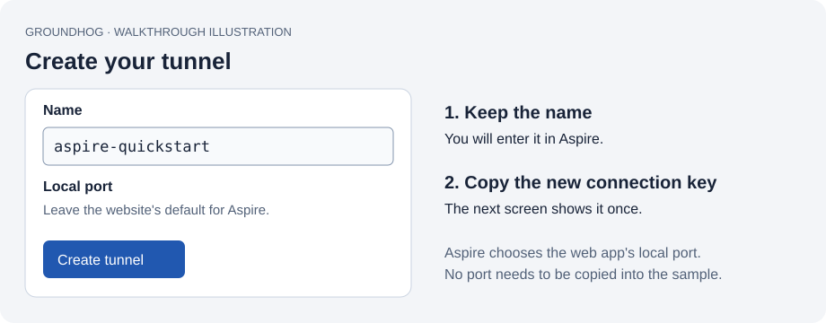

# Your first Groundhog tunnel with Aspire

Run a small web app on your computer and open it through a public HTTPS address. Groundhog runs inside the Aspire AppHost: you do not need to install the Groundhog CLI or host a backend.

This walkthrough uses **0.2.0-preview.3**.

## 1. Check your tools

You need the [.NET 10 SDK](https://dotnet.microsoft.com/download/dotnet/10.0), the [Aspire CLI](https://aspire.dev/get-started/install-cli/), and a Groundhog account. The sample uses Aspire AppHost SDK 13.6.1. In a terminal, check:

```text
dotnet --version
aspire --version
```

The first command should report `10.x`; use Aspire CLI 13.6 or later.

## 2. Create a tunnel in the Groundhog website

Sign in to Groundhog and open your workspace's **Tunnels** page. Choose **New tunnel**.



- **Name:** enter `aspire-quickstart`, or another available name. Keep a note of the exact name.
- **Local port:** leave the website's default for this Aspire sample. This field only fills in the standalone CLI command the website offers; it does not configure Aspire or store a port on the server. The sample automatically forwards to its web app's actual port.
- Create the tunnel. Copy its **connection key** and keep it somewhere private while you complete this guide. The website shows a new key once. If you have lost it, regenerate the key on the tunnel's page and use the new one.

You now have two values to enter in Aspire: **the name** and **the connection key**. The website also shows a public HTTPS address. You will open that address after starting the sample. Do not paste that address into the tunnel-name field.

## 3. Download the sample and open its folder

Clone this repository, or download its ZIP from GitHub's **Code** menu and extract it. If you use Git:

```text
git clone https://github.com/Unifinity-Software/groundhog-client.git
cd groundhog-client/samples/AspireQuickstart
```

If you downloaded the ZIP, open a terminal in the extracted `samples/AspireQuickstart` folder instead. You should see the `AppHost` and `Web` folders. This sample installs the integration from NuGet; its only project reference is the example web app.

## 4. Start Aspire and enter your two values

Run this command from the sample folder:

```text
aspire start --apphost AppHost/AppHost.csproj
```

Follow the dashboard link Aspire prints. When the unresolved-parameters form appears:


| Field | Exactly what to enter |
| --- | --- |
| `groundhog-name` | `aspire-quickstart`, or the name you created in step 2. Name only: no `https://`, dots or domain. |
| `groundhog-key` | Paste the connection key from step 2. It is not your account password. |

Turn on **Save to user secrets**, then submit the form. This remembers the values on this computer so you do not have to paste the key every time. User secrets live outside the repository and are not encrypted. Leave the toggle off if you do not want Aspire to remember the values.

There is no service-address question in this version. The client connects to the hosted Groundhog service automatically. If you see `groundhog-relay`, you are running the older preview.2 sample. That version needs the address beside **Relay** at the bottom of the website's Tunnels page.

Keep your key out of source files, screenshots and terminal commands. For manual configuration, use the AppHost project's **Manage User Secrets** editor with `Parameters:groundhog-name` and `Parameters:groundhog-key`.

## 5. Open your app through the tunnel

In the Aspire dashboard, wait for `web` to start and `tunnel` to show **Running**. Open the public HTTPS address listed on the `tunnel` resource. Alternatively, open the public address on your tunnel's page in the Groundhog website. Keep the AppHost running.

The `web` resource's localhost link checks only the app on your computer. Use the **public** address to check Groundhog.


The browser should show JSON containing:

```json
{
  "message": "Hello through Groundhog",
  "publicOrigin": "https://aspire-quickstart.tunnel.example.com",
  "host": "aspire-quickstart.tunnel.example.com"
}
```

Your address replaces the example. Seeing **Hello through Groundhog at the public HTTPS address** confirms the complete path works: browser → Groundhog → your local web app → browser. You can now share the public address while your sample is running.

## 6. Stop the sample

From the same sample folder:

```text
aspire stop --apphost AppHost/AppHost.csproj
```

The app will stop serving through the public address. Starting the sample again uses the values you saved.

## If something goes wrong

| What you see | What to do |
| --- | --- |
| `NU1102`, or NuGet only finds an older preview | Run the restore command below, then start again. Check that the preview named in this guide has been published. |
| `groundhog-relay` is still requested | You have the preview.2 sample. Use the version link above, or update your sample to preview.3. |
| The tunnel rejects the credentials | Check that the name matches the website and the key belongs to that tunnel. A regenerated key replaces the previous key. Correct the saved values and restart the sample. |
| The tunnel stays Connecting or Reconnecting | Check your internet connection and the tunnel's console logs in Aspire. The local app can run while Groundhog is unreachable. |
| The public URL does not return the JSON | Confirm both `web` and `tunnel` are Running, that you opened this tunnel's public address, and that the AppHost is still running. Check the tunnel console for the request and any forwarding error. |

For a stale NuGet response:

```powershell
dotnet restore AppHost/AppHost.csproj --source https://api.nuget.org/v3/index.json --no-http-cache
```

To correct saved values, stop the sample, open **Manage User Secrets** on `AppHost/AppHost.csproj`, edit `Parameters:groundhog-name` or `Parameters:groundhog-key`, and start again. Do not share that file.

## Use Groundhog in your own AppHost

See the [Aspire integration guide](../../docs/aspire.md). You choose which local endpoint to expose with `.WithReference(...)`; no fixed local port is necessary. This sample uses HTTP on loopback and HTTPS publicly. Local HTTPS endpoints need a certificate trusted by your computer.

For self-hosted Groundhog or a service-address migration, use the explicit-address overload shown in that guide. The client does not create accounts or tunnels. Publish mode omits the development tunnel.

The pictures above are illustrations with placeholder data, not screenshots of a live account.
